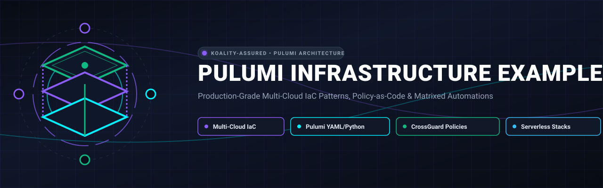

<div align="center">



# Pulumi Infrastructure Examples

<p align="center">
  
</p>

**Production-Grade Multi-Cloud IaC Patterns, Policy-as-Code & Matrixed Automations**

[](https://github.com/Koality-Assured/pulumi-examples/actions/workflows/ci.yml)
[](LICENSE)
[]()
[](https://conventionalcommits.org)

</div>

---

Production-grade, generalized, secure Infrastructure as Code (IaC) architectural patterns and resource examples using [Pulumi](https://www.pulumi.com/).
This repository serves as an authoritative reference for engineering teams deploying multi-cloud infrastructure (AWS, GCP, Linode), SaaS governance (GitHub, Datadog), cross-stack dependencies, multi-account Systems Manager (SSM) governance, compliance guardrails, and matrixed serverless automations.
> [!NOTE]
> **Advisory & Reference Only**: All examples are generalized and sanitized. No real GitHub Actions workflows execute against live cloud environments from this repository, and no live infrastructure is mutated. Use these architectures as blueprints for production stacks.

---

## Repository Map & Navigation
The repository is partitioned into three functional domains:
```
pulumi-examples/
├── 01-resource-types/           # Deploying foundational resources successfully
│   ├── aws/                     # Networking, Compute, Load Balancing, API Gateway, Storage, Identity, Edge
│   ├── gcp/                     # Workload Identity Federation (WIF) & Regional SSL Policies
│   ├── linode/                  # Multi-Cloud Compute & Cloud Firewall
│   └── saas/                    # GitHub Organization-as-Code & Datadog Observability
│
├── 02-complex-patterns/         # Advanced architectural topologies & governance
│   ├── cross-stack-references/  # Decoupled micro-stacks via StackReference
│   ├── hub-and-spoke-governance/# Multi-account Systems Manager (SSM) hub & spoke onboarding
│   ├── multi-region-routing/    # Active-passive Route53 DNS failover with health checks
│   ├── policy-as-code-crossguard/# TypeScript CrossGuard policy pack (AWSGuard + custom rules)
│   └── pulumi-managing-pulumi/  # Pulumi Service Provider managing teams, RBAC, and ESC
│
└── 03-matrixed-automations/     # Programmatic scale & event-driven serverless
    ├── multi-environment-matrix/# Programmatic Python matrix expansion ([env] x [region])
    └── event-driven-lambdas/    # Threat enrichment, automated quarantine, and FinOps hygiene
```
---
## 1. Resource Types (`01-resource-types/`)
Step-by-step implementations demonstrating how to provision isolated cloud resources following CIS benchmarks and defense-in-depth principles:
| Provider | Component | Runtime | Highlights & Capabilities | Directory |
| :--- | :--- | :--- | :--- | :--- |
| **AWS** | **Networking** | Pulumi YAML | VPC (`/16`), segregated public/private subnets (`/24`), NAT Gateway, Elastic IP, Route Tables, and application security groups. | [`01-resource-types/aws/networking/`](./01-resource-types/aws/networking/) |
| **AWS** | **Compute** | Pulumi YAML | Ubuntu 22.04 LTS dynamic AMI query (`fn::invoke`), KMS CMK root volume encryption, IMDSv2 mandatory tokens, and bastionless SSM instance profiles. | [`01-resource-types/aws/compute/`](./01-resource-types/aws/compute/) |
| **AWS** | **Load Balancing** | Pulumi YAML | Application Load Balancer (ALB), Target Groups with `/healthz` probes, port 80-to-443 TLS redirect, and modern TLS 1.3 negotiation policies. | [`01-resource-types/aws/loadbalancing/`](./01-resource-types/aws/loadbalancing/) |
| **AWS** | **API Gateway** | Pulumi YAML | API Gateway v1 REST API resource trees (`/api/v1/health`), method definitions, zero-compute `MOCK` liveness responses, and deployment stages. | [`01-resource-types/aws/apigateway/`](./01-resource-types/aws/apigateway/) |
| **AWS** | **Storage** | Pulumi YAML | Hardened S3 bucket with KMS CMK encryption, S3 Public Access Block (all 4 vectors), TLS 1.2+ mandatory bucket policy, and Glacier lifecycle rules. | [`01-resource-types/aws/storage/`](./01-resource-types/aws/storage/) |
| **AWS** | **Identity & OIDC** | Pulumi YAML | Keyless CI/CD authentication via AWS IAM OpenID Connect (OIDC) identity federation with GitHub Actions, replacing static long-lived access keys. | [`01-resource-types/aws/identity/`](./01-resource-types/aws/identity/) |
| **AWS** | **Edge & CDN** | Pulumi YAML | CloudFront CDN distribution with active-passive origin failover groups, custom SPA error rewriting, and AWS WAFv2 WebACL inspection. | [`01-resource-types/aws/edge/`](./01-resource-types/aws/edge/) |
| **GCP** | **Workload Identity**| Pulumi YAML | Keyless Google Cloud authentication for GitHub Actions using Workload Identity Federation (WIF) and repository assertion conditions. | [`01-resource-types/gcp/workload-identity/`](./01-resource-types/gcp/workload-identity/) |
| **GCP** | **Security Policies**| Pulumi YAML | Regional SSL Policy (`RegionSslPolicy`) enforcing `profile: RESTRICTED` and `minTlsVersion: TLS_1_2` on Google Cloud Load Balancers. | [`01-resource-types/gcp/security-policies/`](./01-resource-types/gcp/security-policies/) |
| **Linode**| **Multi-Cloud VM** | Pulumi YAML | Independent virtual machine provisioning with private datacenter networking, Cloud Firewall with default DROP policy, and scoped API tokens. | [`01-resource-types/linode/compute-and-firewall/`](./01-resource-types/linode/compute-and-firewall/) |
| **SaaS** | **GitHub Org** | Pulumi YAML | Declarative GitHub Organization management: teams, secure repository templates with secret scanning enabled, branch protections, and RBAC grants. | [`01-resource-types/saas/github-org/`](./01-resource-types/saas/github-org/) |
| **SaaS** | **Datadog Observability** | Pulumi Python | Observability-as-Code: APM P99 latency alerts, 5xx error rate monitors, recurring weekly maintenance downtime windows, and global synthetic tests. | [`01-resource-types/saas/datadog-monitoring/`](./01-resource-types/saas/datadog-monitoring/) |
---
## 2. Complex Architectural Patterns (`02-complex-patterns/`)
Enterprise patterns solving coordination, blast radius isolation, multi-account governance, and compliance evaluation:
| Pattern | Runtime | Architecture Summary | Directory |
| :--- | :--- | :--- | :--- |
| **Cross-Stack References** | Pulumi YAML | Decouples shared networking infrastructure from rapidly changing application stacks using `pulumi:pulumi:StackReference`. Network exports (`vpcId`, `subnetIds`) are consumed dynamically without code duplication. | [`02-complex-patterns/cross-stack-references/`](./02-complex-patterns/cross-stack-references/) |
| **Hub-and-Spoke Governance** | Pulumi YAML / CloudFormation | Multi-account Systems Manager (SSM) management: central session preferences (`SSM-SessionManagerRunShell`) with KMS encryption and log streaming, multi-OS patch baselines (`tier-critical`, `tier-standard`), Resource Data Sync S3 lake, and spoke account onboarding. | [`02-complex-patterns/hub-and-spoke-governance/`](./02-complex-patterns/hub-and-spoke-governance/) |
| **Multi-Region Routing** | Pulumi YAML | Active-passive disaster recovery DNS routing using Amazon Route53. Probes primary region health (`us-east-1`) over HTTPS and triggers sub-minute automated failover to the standby region (`us-west-2`) upon health check failure. | [`02-complex-patterns/multi-region-routing/`](./02-complex-patterns/multi-region-routing/) |
| **Policy-as-Code (CrossGuard)**| TypeScript | Pre-deployment compliance evaluation using Pulumi CrossGuard. Enforces `@pulumi/awsguard` standards alongside mandatory custom rules: required FinOps tagging, EC2 IMDSv2 enforcement, and S3 encryption at rest. | [`02-complex-patterns/policy-as-code-crossguard/`](./02-complex-patterns/policy-as-code-crossguard/) |
| **Pulumi-Managing-Pulumi** | Pulumi Python | Meta-infrastructure automation using `pulumi-pulumiservice`. Manages Pulumi Cloud teams, maps RBAC stack permissions (`admin`, `edit`, `read`), and generates Pulumi ESC environments with automated OIDC AWS session generation. | [`02-complex-patterns/pulumi-managing-pulumi/`](./02-complex-patterns/pulumi-managing-pulumi/) |
---
## 3. Matrixed Automations (`03-matrixed-automations/`)
Automation patterns utilizing programming constructs and serverless workflows to eliminate repetitive operational toil:
| Pattern | Runtime | Architecture Summary | Directory |
| :--- | :--- | :--- | :--- |
| **Multi-Environment Matrix** | Pulumi Python | Algorithmically expands an environment matrix (`[dev, staging, prod]` x `[regions]`), dynamically instantiating regional `aws.Provider` objects, calculating non-overlapping CIDR blocks, and enforcing tier-specific log retention. | [`03-matrixed-automations/multi-environment-matrix/`](./03-matrixed-automations/multi-environment-matrix/) |
| **Threat Enrichment Pipeline** | Pulumi YAML / Python | Asynchronous threat intelligence processing pipeline: SQS FIFO queues with content-based deduplication, dead-letter queue (DLQ) retry policies, 15-second batching windows, and serverless enrichment workers. | [`03-matrixed-automations/event-driven-lambdas/threat-enrichment/`](./03-matrixed-automations/event-driven-lambdas/threat-enrichment/) |
| **Incident Quarantine Automation** | Pulumi YAML / Python | Automated incident response triggered by high-severity Amazon GuardDuty findings: automatically snapshots target EBS volumes for digital forensics, and attaches an empty isolation security group to sever active network connections. | [`03-matrixed-automations/event-driven-lambdas/incident-quarantine/`](./03-matrixed-automations/event-driven-lambdas/incident-quarantine/) |
| **Resource Hygiene Monitor** | Pulumi YAML / Python | Scheduled FinOps auditor triggered by a daily EventBridge cron rule (`cron(0 6 * * ? *)`), scanning for unattached EBS storage volumes and unassociated Elastic IPs incurring idle cloud waste. | [`03-matrixed-automations/event-driven-lambdas/resource-hygiene-monitor/`](./03-matrixed-automations/event-driven-lambdas/resource-hygiene-monitor/) |
---
## Runtimes & Conventions
Pulumi supports multiple language runtimes. This repository demonstrates the strengths of each:
- **Pulumi YAML (`runtime: yaml`)**: Declarative, low-friction, ideal for standardized infrastructure blueprints, resource definitions, and CI/CD pipelines where external logic is unnecessary.
- **Pulumi Python (`runtime: python`)**: Imperative power, ideal for matrix expansions, dynamic provider management, API integrations, and complex data models.
- **Pulumi TypeScript / CrossGuard (`runtime: nodejs`)**: Type-safe policy engine for static analysis and runtime policy evaluation against infrastructure graphs.
---
## Adversarial Quality & Security Audit
This repository enforces strict sanitization standards to guarantee zero leaks of private credentials, internal identifiers, employee names, or realistic account numbers.
To execute the adversarial audit locally:
```bash
python adversarial_review.py
```
The auditor executes four verification phases:
1. **Forbidden Identifier Scan**: Scans all files against a forbidden term registry.
2. **Syntax Verification**: Parses every YAML, Python, and JSON file using native parsers.
3. **Execution Policy Enforcement**: Confirms no real running GitHub Actions workflows exist.
4. **Documentation Coverage**: Verifies every example directory maintains an informative README.
---
## License
This project is licensed under the [MIT License](./LICENSE). Copyright (c) 2026 Koality Assured.
